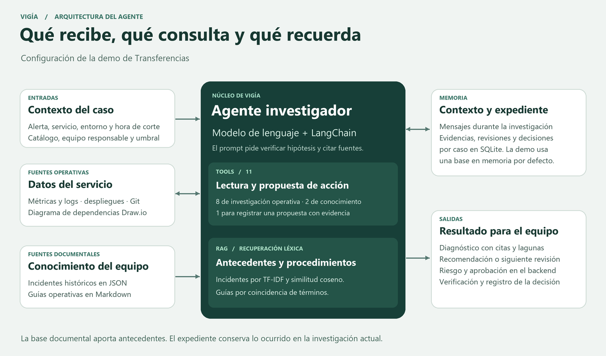

# Vigía · Arquitectura funcional del agente

## Qué recibe y qué produce

La investigación recibe una alerta con servicio, entorno, métrica y hora de corte. El catálogo aporta alias, equipo responsable, repositorio, referencia de arquitectura y umbral. El agente combina estos datos con instrucciones para contrastar hipótesis y citar sus fuentes. Su salida es un diagnóstico sustentado, una acción propuesta o una comprobación pendiente si falta evidencia. El backend gestiona el riesgo, las decisiones humanas y la verificación. [Investigador](../src/vigia/application/investigator.py) · [Prompt](../src/vigia/application/prompts.py)

## Herramientas y fuentes

| Función | Herramientas | Fuente o destino en la demo |
| --- | --- | --- |
| Medir la degradación y examinar errores | `query_metrics`, `detect_anomaly`, `search_logs` | Métricas CSV y logs locales |
| Localizar una dependencia y su versión activa | `query_dependencies`, `list_changes`, `resolve_release` | Diagrama Draw.io e historial JSON de despliegues |
| Inspeccionar la versión desplegada | `compare_revisions`, `read_snippet` | Repositorios Git autorizados |
| Recuperar conocimiento previo | `search_similar_incidents`, `search_runbook` | Incidentes JSON y guías Markdown |
| Proponer una intervención | `propose_action` | Servicio de aprobaciones del backend |

## Qué tipo de RAG usa

El agente incorpora al contexto los resultados de dos herramientas de recuperación. Para incidentes, compara la descripción del problema con el historial mediante TF-IDF y similitud coseno. Para guías, ordena los documentos por coincidencia de términos y devuelve condiciones y pasos. En el ejemplo de Transferencias, esto permite consultar cómo se resolvió un agotamiento del pool de conexiones antes de recomendar una intervención. [Recuperación de conocimiento](../src/vigia/adapters/outbound/knowledge.py)

## Qué memoria tiene

- **Durante la investigación**, los mensajes y resultados de herramientas forman el contexto de la ejecución de LangChain.
- **Por caso**, el expediente almacena alerta, revisiones, evidencias, propuesta, decisión y verificación. El servicio usa SQLite en memoria por defecto cuando no se inyecta otro almacén. Un almacén SQLite configurado en disco permite retomar los expedientes después de reiniciar.
- **Entre casos**, el conocimiento reutilizable procede del corpus de incidentes y guías consultado por las herramientas de recuperación. La incorporación de nuevos antecedentes a ese corpus es independiente del guardado del expediente.

[Servicio de casos](../src/vigia/application/case_service.py) · [Almacén SQLite](../src/vigia/adapters/outbound/case_store.py) · [Configuración de la demo](../src/vigia/runtime.py)
